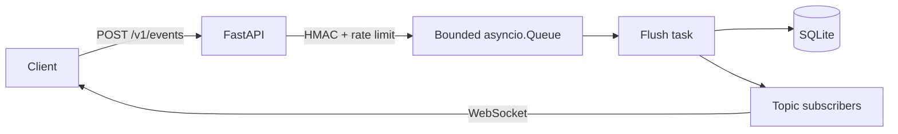

# streamforge-api

Async webhook ingestion for small services. It verifies signed requests, applies per-IP rate limits, queues events in memory, writes SQLite batches, and publishes events to WebSocket subscribers.

## Architecture



The queue is bounded. A full queue returns `503` with `Retry-After: 1`. Events are inserted with `INSERT OR IGNORE` using `event_id` as the key. A duplicate request is accepted but does not increase `persisted_total`.

## Configuration

| Variable | Default | Use |
| --- | --- | --- |
| `STREAMFORGE_HMAC_SECRET` | `change-me` | HMAC secret |
| `STREAMFORGE_DB_PATH` | `streamforge.db` | SQLite path |
| `STREAMFORGE_QUEUE_SIZE` | `1000` | Maximum queued events |
| `STREAMFORGE_BATCH_SIZE` | `50` | Maximum events per write |
| `STREAMFORGE_FLUSH_INTERVAL` | `0.5` | Flush timeout in seconds |
| `STREAMFORGE_RATE_LIMIT` | `120` | Requests per IP per 60 seconds |

## Run

```sh
python -m venv .venv
. .venv/bin/activate
pip install -r requirements.txt
export STREAMFORGE_HMAC_SECRET=local-secret
uvicorn streamforge.app:app --app-dir src --reload
```

The request signature is `sha256=<hex>` over `f"{timestamp}." + raw_body`, using `X-Streamforge-Timestamp` and `X-Streamforge-Signature` headers.

```sh
body='{"topic":"orders","source":"billing","payload":{"amount":42},"timestamp":"2026-01-01T00:00:00Z"}'
timestamp=$(date +%s)
signature=$(printf '%s.%s' "$timestamp" "$body" | openssl dgst -sha256 -hmac "$STREAMFORGE_HMAC_SECRET" -hex | awk '{print $2}')
curl -X POST http://localhost:8000/v1/events \
  -H 'Content-Type: application/json' \
  -H "X-Streamforge-Timestamp: $timestamp" \
  -H "X-Streamforge-Signature: sha256=$signature" \
  --data "$body"
```

Connect to `ws://localhost:8000/v1/stream/orders`. Use `*` instead of `orders` for all topics.

## Endpoints

- `POST /v1/events` accepts a signed event and returns `202`.
- `WS /v1/stream/{topic}` streams matching events.
- `GET /v1/stats` returns queue and subscriber counters.
- `GET /health` checks the SQLite connection.

## Tests

```sh
pytest -v
python -m compileall src tests
```
